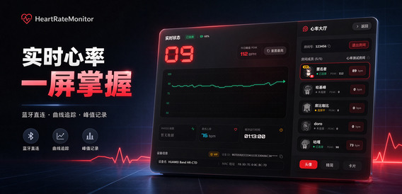
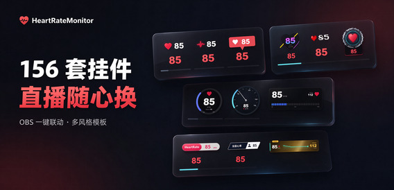
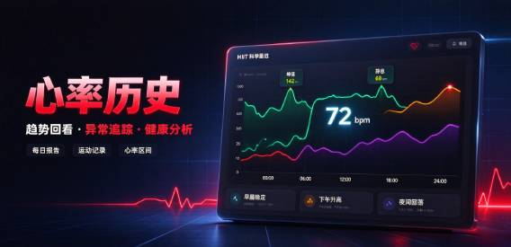

  <h1>❤️ HeartRateMonitor</h1>
  
<strong>实时心率，一屏掌握 —— 专为直播、开黑、虚拟偶像与运动健康打造的跨平台心率监控与多端联动工具</strong>

  

    
    
    
    
  

---

## ✨ 项目简介

**HeartRateMonitor** 是一款基于 **Tauri + React + Python** 构建的现代化桌面端实时心率监控中心。它能够直接通过蓝牙（BLE）连接常见智能手环/心率带，将枯燥的生理数据转化为极具视觉冲击力的桌面悬浮挂件、OBS 直播联动特效、VRChat / VTube Studio 虚拟形象驱动以及多人联机开黑互动体验。

---

## 🚀 核心功能亮点

### 1. 📡 蓝牙直连与高精度生理指标监控
* **BLE 心率设备直连**：一键扫描并连接支持标准蓝牙心率广播（HRS）的手环、手表及心率带，支持自动重连与设备电量实时显示。
* **多维数据看板**：实时追踪当前心率（BPM）、今日峰值（PEAK）、最低心率、平均心率以及 **RMSSD / HRV（心率变异性与压力评估）**。
* **受惊状态自动识别**：当心率出现剧烈波动或飙升时自动触发 `受惊状态`，界面边缘呈现呼吸红光预警，并联动下游特效。

### 2. 👥 心率大厅：多人同屏实时互动
* **创建 / 加入开黑房间**：支持一键创建公开或加密房间（最多 5 人同房），与好友、队友或直播水友实时共享心跳。
* **多种悬浮显示模式**：独立透明房间悬浮窗支持 **头像模式**、**精简模式** 与 **卡片模式** 自由切换，支持自定义头像、昵称及 VIP 徽章展示。
* **连接状态同步**：实时反馈房间内每位成员的设备连接状态（已连接 / 连接中 / 重连中 / 未连接）与峰值排行。

### 3. 🎨 156+ 套直播心率挂件与桌面悬浮窗
* **海量精美模板**：内置 **156 套风格各异的心率挂件**（经典数字、心电动态波形、游戏主题、仪表盘等），直播画面随心切换。
* **桌面级透明挂件**：支持无边框置顶显示、滚轮/滑块自由无极缩放（`0.4x ~ 1.6x`）、鼠标穿透锁定以及全局快捷键呼出。
* **OBS 窗口采集友好**：支持独立配置挂件与房间窗口的任务栏显示开关，完美适配 OBS Studio 窗口采集与浏览器源接入。

| 156 套挂件随心换 | 多风格实时展示 |
| :---: | :---: |
|  |  |

### 4. 🎬 全生态直播与虚拟主播联动
* **OBS Studio 深度联动**：内置本地 OBS WebSocket（默认端口 `4455`）控制，支持**受惊自动切换场景 / 触发滤镜**，以及高能时刻**自动保存 OBS 回放缓存**。
* **虚拟形象驱动**：原生支持 **VTube Studio** 心率插件、**VRChat OSC** 协议推送、**Live2D** 以及 **CodexPets** 桌面宠物联动。
* **多格式数据输出**：支持实时心跳音效提示、心率历史 `.log` 归档以及实时心率 `.txt` 文本输出。

### 5. 🏃 HIIT 科学跟练与心率历史分析
* **HIIT 科学跟跳模式**：内置循序渐进、标准循环、智能高强度等多种训练课程，结合心率区间提供实时强度反馈、连击（COMBO）与能量加成激励。
* **心率历史趋势看板**：支持全天候趋势回看、峰值/静息对比、异常波动追踪与休闲心率小游戏。

| HIIT 科学跟练 | 心率历史分析 |
| :---: | :---: |
|  |  |

---

## ⌨️ 默认全局快捷键

您可以在主界面右上角 **快捷功能面板 -> 设置** 中随时自定义以下全局快捷键（修改后立即生效）：

| 功能说明 | 默认快捷键 | 备注 |
| :--- | :---: | :--- |
| **显示 / 隐藏桌面挂件** | `Ctrl + Alt + O` | 快速控制主心率悬浮窗显隐 |
| **锁定 / 解锁桌面挂件** | `Ctrl + Alt + L` | 锁定后开启鼠标点击穿透，防止游戏误触 |

---

## 📦 快速上手指南

1. **下载安装**：前往 [Releases 页面](https://github.com/wang0227-demo/HeartRateMonitor/releases) 下载最新版本的安装包并运行。
2. **开启手环广播**：在您的智能手环或手表设置中开启 **“心率广播”** 功能（请确保设备未同时被手机 App 占用）。
3. **扫描连接**：点击主界面右侧 **“扫描”** 按钮，选择您的蓝牙设备并点击 **“选择并连接”**。
4. **开启挂件或联动**：
   * 点击 **“显示挂件”** 即可在桌面/游戏画面上方置顶查看心率；
   * 在快捷功能面板中打开 **“心率挂件”** 获取 OBS 浏览器源地址，或进入 **“心率大厅”** 与好友联机。

---

## 🛠️ 技术栈架构

* **前端界面**：React + TypeScript + Tailwind CSS + Lucide Icons + HTML5 Canvas 实时波形渲染
* **桌面容器**：Tauri v2（多窗口管理、透明穿透悬浮窗、全局快捷键、系统托盘状态联动）
* **核心后端**：Python（BLE 蓝牙通信、WebSocket 实时数据分发、OBS WebSocket 控制、VRChat OSC、本地 HTTP API）

---

## 💬 社区与反馈

<<<<<<< HEAD
* **最新版本下载**：[GitHub Releases](https://github.com/wang0227-demo/HeartRateMonitor/releases)
* **官方交流群**：[点击加入 QQ 交流群](https://qm.qq.com/q/X6rnS0WBUI)（获取使用教程、设备兼容性列表及最新内测动态）
